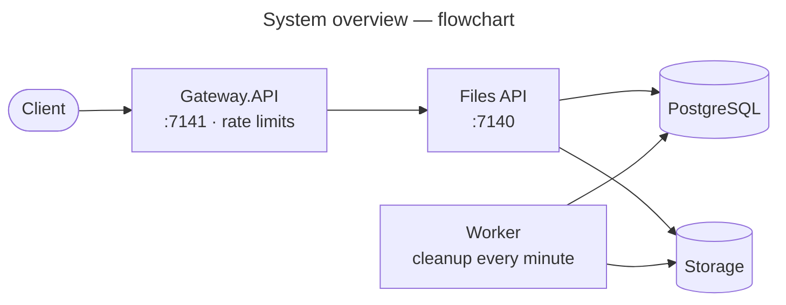

<p align="center">
  
</p>

# GM.FileStorage Samples

[](https://github.com/gmetskhvarishvili/GM.FileStorage.Samples/actions/workflows/ci.yml)
[](LICENSE)

A layered **DDD + CQRS** file-storage sample built on the **GM.\*** ecosystem: streaming upload/download,
keys organised by file type, delete and presigned links through the
provider-agnostic `IFileStorageService` — plus a **PostgreSQL catalog** of every stored file and its
metadata, so files can be listed by tenant or user, inspected by id, soft-deleted and restored. Targets
**.NET 10** and **PostgreSQL**.

It assembles **[GM.FileStorage](https://www.nuget.org/packages/GM.FileStorage)** with its
**[Local](https://www.nuget.org/packages/GM.FileStorage.Local)**,
**[S3](https://www.nuget.org/packages/GM.FileStorage.S3)** and
**[AzureBlob](https://www.nuget.org/packages/GM.FileStorage.AzureBlob)** providers,
**[GM.FileStorage.Domain](https://www.nuget.org/packages/GM.FileStorage.Domain)** +
**[GM.FileStorage.Persistence](https://www.nuget.org/packages/GM.FileStorage.Persistence)** (the stored-file
catalog), **[GM.API](https://www.nuget.org/packages/GM.API)** (Web API startup, versioning, Swagger, errors,
request logging, health, secrets), **[GM.Mediator](https://www.nuget.org/packages/GM.Mediator)** (CQRS
dispatch) and **[GM.EntityFramework](https://www.nuget.org/packages/GM.EntityFramework)** (repository / unit of
work / domain-event store / actor auditing). Clients reach it through a
**[GM.Gateway](https://www.nuget.org/packages/GM.Gateway)** edge with per-IP rate limits, and a separate
worker runs the storage-cleanup job on **[GM.Scheduling](https://www.nuget.org/packages/GM.Scheduling)**.
The layout mirrors [GM.Identity.Samples](https://github.com/gmetskhvarishvili/GM.Identity.Samples).



**Docs** ([all diagrams, by action and by doc](docs/README.md))

| Doc | Diagrams |
| --- | --- |
| [Architecture](docs/architecture.md) | Processes, layers, data model, scaling out |
| [Dependencies](docs/dependencies.md) | Runtime calls, project references, packages, classes behind a request, domain model |
| [User flows](docs/user-flows.md) | File lifecycle, the gateway's checks, and one flowchart per action with every outcome |
| [Sequence diagrams](docs/sequence-diagrams.md) | Startup, the gateway, every endpoint, encryption, cleanup, health, Swagger |
| [Configuration](docs/configuration.md) | Where each setting and secret comes from |

> Every `GM.FileStorage*` reference here is pinned to **2.0.0** (the packages release in lockstep). 2.0.0 adds
> encryption at rest, key templates and upload rules, and removes `GMStoredFile.Replace`: a file's content
> never changes after upload.

## Layers

| Project | Role |
| --- | --- |
| `GM.FileStorage.Sample.Domain` | `StoredFile` / `StoredFileMetadata` aggregates (specialising GM.FileStorage's `GMStoredFile` / `GMStoredFileMetadata`), repository interfaces, `StoredFileSpecification` (visibility, tenant/user metadata, storage folder, paging), `IUnitOfWork` |
| `GM.FileStorage.Sample.Application` | Commands and queries (`Files/Commands/UploadFile`, `DeleteFile`, `RestoreFile`; `Files/Queries/GetFilesList`, `GetFileDetails`, `DownloadFile`, `GetFilePresignedUrl`) — request, FluentValidation validator and GM.Mediator handler in one file; Mapster `MappingRegister` |
| `GM.FileStorage.Sample.Persistence` | `ApplicationDbContext` (GM.EntityFramework `GenericDbContext` + domain-event dispatch), the GM.FileStorage configurations mapped to `file_storage.stored_files` / `stored_file_metadata` (`FileStorageTableNames`: the library's names without the `gm_` prefix), repositories, unit of work, migrations, `AddPersistence` (Npgsql + snake_case + actor auditing) |
| `GM.FileStorage.Sample.Infrastructure` | `AddInfrastructure` (API): GM.FileStorage + the Local/S3/AzureBlob providers, encryption, the database readiness check. `AddWorkerInfrastructure` (worker): the providers plus `StorageCleanupJob` on GM.Scheduling |
| `GM.FileStorage.Sample.Common` | `StringResource` (display names, error parts) and the `GMExceptionsResource` messages GM.Exceptions formats |
| `GM.FileStorage.Sample.API` | GM.API host; `Files/FilesController` sends mediator requests and maps its `*Model`s with Mapster |
| `GM.FileStorage.Sample.Gateway.API` | The public edge: GM.Gateway (YARP) forwarding to the API, GM.RateLimiting per IP (uploads 30/min, everything else 300/min), Swagger UI at `/`, readiness that checks the API |
| `GM.FileStorage.Sample.Worker` | Generic host that runs `StorageCleanupJob` every minute; no HTTP surface |
| `tests/GM.FileStorage.Sample.Tests` | End-to-end tests over HTTP (`GmWebApplicationFactory<Program>`) and aggregate guards |

## What it demonstrates

- **One GUID per file; its storage location shown.** A file is identified by a GUID, its id, which is also
  its key; every route uses it. Its bytes are stored under folders from `FileStorage:KeyTemplate` (see
  below). Responses show only the stored object's name, as `storageKey`; the folders stay internal.
- **Bytes in storage, facts in the catalog.** `UploadFile` streams the request into `IFileStorageService`,
  then records a `StoredFile` row plus one `StoredFileMetadata` row per pair (tenant, user) and saves
  through the unit of work. If the save fails, the uploaded bytes are deleted and the error rethrown, so
  storage never keeps unreferenced objects.
- **Uploads stream, never buffer.** The upload endpoints take no `IFormFile` (binding one makes ASP.NET buffer the
  whole form, to disk past 64 KB, before any code runs). They read file parts straight off the request
  (`Files/Multipart/MultipartFiles`) into storage, so a file over `FileStorage:MaxFileSize` is cut off as soon as
  it passes the limit, without reading the rest. Swagger still shows the file pickers
  (`MultipartUploadOperationFilter`).
- **Batch uploads.** `POST /files/batch` takes up to 20 files and stores each as a single upload would (its own
  id, rules and transaction), answering with one result per file. A file that fails doesn't stop the rest, so a
  client resends only the failed ones.
- **Refusing a request after storing part of it.** Streaming means a second file (on the single endpoint) or a 21st
  (in a batch) is only seen after earlier ones are stored. Those are then discarded — rows removed, bytes queued
  for cleanup and deleted — and the request gets a 400 with nothing kept.
- **Content never changes.** There is no replace endpoint: once uploaded, a file's bytes stay as they were.
  New content is a new upload with a new id.
- **Soft delete, easy restore.** `DeleteFile` only marks the row deleted (hidden from list, details, download
  and presign; visible with `visibility=All`). The bytes stay in storage, so `RestoreFile` brings the file back
  exactly as it was, without a re-upload.
- **Searchable metadata.** The list filters by tenant/user with `Metadata.Any(...)` sub-queries served by the
  `(name, value)` index, plus storage folder and content type, with GM.API paging (`X-Pagination` header).
- **Domain events.** `GMStoredFileUploaded/Deleted/RestoredDomainEvent`s are written to
  `domain_events.domain_events` in the same transaction and dispatched in-process after the save.
- **All three backends wired at once** — `FileStorage:Provider` (default `"Local"`) chooses which one is
  active, so switching disk → S3 → Azure is a **config change, not a code change**. The cloud clients are
  only constructed when their provider is selected.
- **GM.API hosting** — Swagger UI at `/` (styled by `Assets/`), health checks at `/health/live|ready|startup`
  (ready includes the database), request logging that describes upload/download bodies instead of reading
  them, RFC 7807 errors (`NotFoundException` → 404), and secrets layered into configuration.

## Storage layout

A file is identified by a GUID, for example `9f1cb2d4-…`. Where its bytes are stored is a separate
**storage key**, made from `FileStorage:KeyTemplate` in appsettings.json, with no code involved:

```jsonc
"KeyTemplate": "{category}/{shard}/{id}{ext}"   // → documents/9f/9f1cb2…a3.pdf, images/4e/4e07…png
```

Responses show only the stored object's name as `storageKey` (`9f1cb2…a3.pdf`); the folders are an internal
layout detail.

- **`{category}` can't lie.** It's `documents`, `images`, `videos`, `audio`, `archives` or `other`,
  from the content type. With `VerifyContentType` on, an upload whose bytes don't match its declared
  type is rejected, so a renamed `.exe` can't land in `images/`.
  - The sample builds the storage key before uploading, from the declared type, so an
    `application/octet-stream` upload lands in `other/`.
  - When the library generates the key itself, it uses the detected type instead.
- **`{shard}` spreads files out.** It's the first two characters of `{id}`, so files spread over 256
  folders per category and no folder grows huge.
- **`{id}{ext}` is a random id plus the file's extension, cleaned up.** `{id}` is required, so
  storage keys never collide.
- **Nothing identifying.** Tenant, user and date stay out of the path. They're searchable metadata in
  the catalog, which is how files are found.
- **Other layouts are a config change.**
  - `{date:yyyy/MM}/{id}{ext}` gives date folders.
  - `{meta:tenantId}/{category}/{id}{ext}` gives per-tenant folders. Metadata values are cleaned
    before use, so they can't add folders or `..`.
  - The template is checked at startup, so a typo fails fast.

The folders also work as a list filter, for example `GET /api/v1/files?folder=images/`.

## Keeping storage and the database in step

The bytes (in `IFileStorageService`) and the catalog row (in Postgres) can't share a transaction. The
sample orders its steps so that any failure leaves at worst bytes nothing points at, and those are
always queued for deletion in the `storage_cleanups` table.

- **Upload** ([UploadFileCommand](GM.FileStorage.Sample.Application/Files/Commands/UploadFile/UploadFileCommand.cs)):
  1. Queue the new storage key for cleanup, due in 15 minutes, before any bytes exist.
  2. Upload the bytes.
  3. In one transaction: create the row and its metadata rows, and drop the queued entry.

  | If this happens… | …the result |
  | --- | --- |
  | A crash after step 2 | The bytes are unreferenced and queued; the job deletes them. |
  | Step 3 fails | No row is created, and the new bytes are deleted (or left queued). |
- **Content never changes**, so stored bytes are never overwritten or swapped out from under a row.
- **Delete** only marks the row deleted and keeps its bytes, so nothing is queued and a restore is instant.
- **`StorageCleanupJob`** ([GM.Scheduling](https://www.nuget.org/packages/GM.Scheduling), every minute, in the
  worker):
  - It carries out due entries, backing off on failures (1, 2, 4 … minutes, at most an hour).
  - An entry whose bytes any file row still uses (live, or deleted and restorable) is dropped, not deleted.
  - Entries are claimed with a concurrency token, so the job and an upload slower than the 15-minute
    grace period can't both act on one.

## Encryption at rest

Off by default. The master key is a secret, so it lives in `appsecrets.json` with the other secrets,
never in appsettings.json. The template, `appsecrets.example.json`, comes with a random demo key
(`local-dev`). Switch encryption on by setting `Enabled` to `true` in your `appsecrets.json`:

```jsonc
// appsecrets.json (gitignored)
{
  "FileStorage": {
    "Encryption": {
      "Enabled": true,
      "ActiveKeyId": "local-dev",
      "Keys": { "local-dev": "<base64 of 32 random bytes>" }
    }
  }
}
```

The template's key is public: it's committed. Anything beyond a local demo needs a key of your own,
generated with `openssl rand -base64 32` and kept safe in your secrets store or password manager. Losing
the key means losing every file it encrypted.

With it on, every file is encrypted with its own AES-256-GCM key, wrapped by the master key
(`GM.FileStorage.Encryption`), so the storage root holds only ciphertext. Over HTTP nothing changes:
uploads, downloads and range requests work as before. The exception is presign, which returns a 400,
because a direct link would serve ciphertext.

## Endpoints

| Method | Route | Purpose |
| --- | --- | --- |
| `POST` | `/api/v1/files?tenantId=&userId=` | Upload one multipart `file`, streamed (several → 400, nothing kept); returns its `id` (a GUID), `storageKey` (the stored name), size, checksum |
| `POST` | `/api/v1/files/batch?tenantId=&userId=` | Upload 1–20 multipart `files`, streamed; returns one result per file, in order: the stored file, or why it wasn't stored (21+ → 400, nothing kept) |
| `GET` | `/api/v1/files?tenantId=&userId=&folder=&contentType=&currentPage=&pageSize=` | Paged list of files, storage key and metadata included |
| `GET` | `/api/v1/files/{id}` | File details (`?visibility=All` includes deleted files) |
| `GET` | `/api/v1/files/{id}/content` | Download the file (streamed; HTTP `Range` → 206) |
| `DELETE` | `/api/v1/files/{id}` | Mark the file deleted (the bytes are kept) |
| `POST` | `/api/v1/files/{id}/restore` | Restore a deleted file as it was |
| `GET` | `/api/v1/files/{id}/presign` | A time-limited link (needs `FileStorage:Local:PublicBaseUrl` for the local provider) |
| `GET` | `/health/live` / `/health/ready` / `/health/startup` | Liveness / readiness / startup probes (GM.API) |
| `GET` | `/` | Swagger UI |

Through the gateway, the same routes are on `https://localhost:7141`. Uploads are limited to
30 per minute per IP, everything else to 300; over the limit you get `429` with `Retry-After`.

## Database setup

The catalog lives in PostgreSQL, database `GMFileStorageSample`. Start one with Docker:

```bash
docker compose up -d   # postgres:16 on localhost:5432, user postgres / password 123456
```

The connection string lives in **`appsecrets.json`** of the API and of the worker, not in `appsettings.json`.
Those files are gitignored. Create them from the committed templates, which hold the docker-compose database's
demo credentials:

```bash
cp GM.FileStorage.Sample.API/appsecrets.example.json GM.FileStorage.Sample.API/appsecrets.json
```

```bash
cp GM.FileStorage.Sample.Worker/appsecrets.example.json GM.FileStorage.Sample.Worker/appsecrets.json
```

```json
{ "ConnectionStrings": { "ApplicationDatabase": "Host=localhost;Port=5432;Database=GMFileStorageSample;Username=postgres;Password=123456" } }
```

The worker reads its own copy. These read the API's:
- GM.API, which layers it over `appsettings.json` through GM.Secrets;
- the tests;
- the design-time factory that `dotnet ef` uses.

For a real database, put its connection string there (or in the secrets store named by `SECRETS_PROVIDER`),
never in a committed file.

The API applies pending migrations on startup, so the schema is created on first run. To add a migration:

```bash
dotnet ef migrations add <Name> -p GM.FileStorage.Sample.Persistence -s GM.FileStorage.Sample.Persistence -o Migrations
```

## Running

Start the three processes, each in its own terminal (the API first: it applies the migrations):

```bash
dotnet run --project GM.FileStorage.Sample.API          # https://localhost:7140
```

```bash
dotnet run --project GM.FileStorage.Sample.Worker       # storage cleanup, every minute
```

```bash
dotnet run --project GM.FileStorage.Sample.Gateway.API  # https://localhost:7141, Swagger UI at /
```

Then call the gateway:

```bash
curl -F "file=@passport.pdf" "https://localhost:7141/api/v1/files?tenantId=acme&userId=u1"
# { "id": "6f1e…-…", "storageKey": "9f1cb2…a3.pdf", "fileName": "passport.pdf", "size": 12345, … }

curl -F "files=@visa.pdf" -F "files=@contract.docx" "https://localhost:7141/api/v1/files/batch?tenantId=acme&userId=u1"
# [ { "fileName": "visa.pdf", "succeeded": true, "file": { "id": "…", … } }, { "fileName": "contract.docx", … } ]

curl "https://localhost:7141/api/v1/files?tenantId=acme"
curl -o passport.pdf "https://localhost:7141/api/v1/files/6f1e…/content"
curl -X DELETE "https://localhost:7141/api/v1/files/6f1e…"
curl -X POST "https://localhost:7141/api/v1/files/6f1e…/restore"
```

The API also works on its own for a quick try. Abandoned uploads then wait in the queue until a worker runs.

Files land under `FileStorage:Local:RootPath`, which is `../App_Data/file-storage`: the repository root's
`App_Data` folder (gitignored), shared by the API and worker. To run on S3/MinIO
or Azure Blob, set `FileStorage:Provider` to `"S3"` or `"AzureBlob"`; no code change is needed.
- **Non-secret settings** (bucket, region, container) go in `appsettings.json`.
- **Credentials** go in `appsecrets.json`, where the template already has empty placeholders:
  - `FileStorage:S3:AccessKey` / `SecretKey`;
  - `FileStorage:AzureBlob:ConnectionString`.

  Alternatively, keep them in the secrets store named by `SECRETS_PROVIDER`.

## Testing

```bash
dotnet test   # with Postgres running and appsecrets.json in place (see Database setup)
```

`FilesEndToEndTests` boot the API in-memory with `GmWebApplicationFactory<Program>` (GM.Testing.AspNetCore)
against a throwaway storage root and drive it over HTTP: upload → list by tenant/user/storage folder → details →
download → presign → delete (row marked deleted, bytes kept) → restore. They also cover batch uploads (one result
per file, a refused file not stopping the rest), the single endpoint refusing several files, Word documents, a 3 MB upload
streamed intact, an oversized upload refused after reading little more than the limit, range requests, the upload rules, the cleanup job, and `PUT` on a file's content being refused (405). They
need PostgreSQL and **no-op when it isn't reachable**; CI runs them against a `postgres` service container.
`AggregateConstructorTests` guard that every aggregate keeps a parameterless constructor for EF.

## License

MIT — see [LICENSE](LICENSE).
