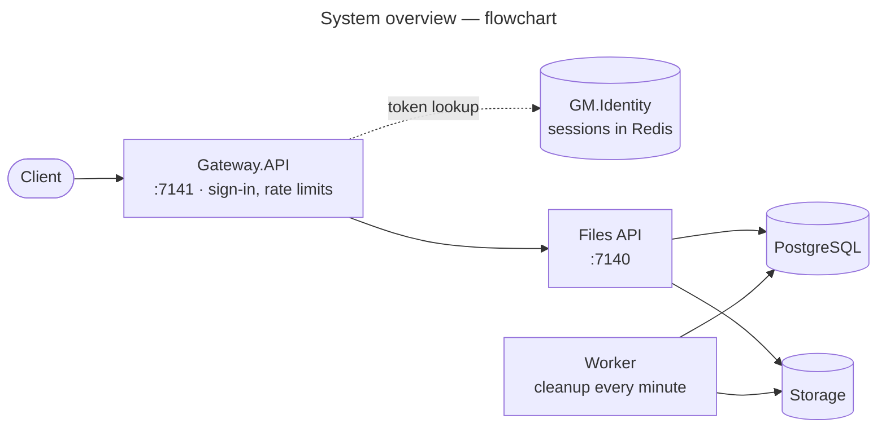

<p align="center">
  
</p>

# GM.FileStorage Samples

[](https://github.com/gmetskhvarishvili/GM.FileStorage.Samples/actions/workflows/ci.yml)
[](LICENSE)

A layered **DDD + CQRS** file-storage sample built on the **GM.\*** ecosystem: streaming upload/download,
keys organised by file type and delete through the
provider-agnostic `IFileStorageService` — plus a **PostgreSQL catalog** of every stored file and its
metadata, so each tenant's files can be listed, inspected by id, soft-deleted and restored. Targets
**.NET 10** and **PostgreSQL**.

It assembles **[GM.FileStorage](https://www.nuget.org/packages/GM.FileStorage)** with its
**[Local](https://www.nuget.org/packages/GM.FileStorage.Local)**,
**[S3](https://www.nuget.org/packages/GM.FileStorage.S3)** and
**[AzureBlob](https://www.nuget.org/packages/GM.FileStorage.AzureBlob)** providers,
**[GM.FileStorage.Domain](https://www.nuget.org/packages/GM.FileStorage.Domain)** +
**[GM.FileStorage.Persistence](https://www.nuget.org/packages/GM.FileStorage.Persistence)** (the stored-file
catalog), **[GM.API](https://www.nuget.org/packages/GM.API)** (Web API startup, versioning, Swagger, errors,
request logging, health, secrets), **[GM.Mediator](https://www.nuget.org/packages/GM.Mediator)** (CQRS
dispatch) and **[GM.EntityFramework](https://www.nuget.org/packages/GM.EntityFramework)** (repository / unit of
work / domain-event store / actor auditing). Clients reach it through a
**[GM.Gateway](https://www.nuget.org/packages/GM.Gateway)** edge with per-IP rate limits, and a separate
worker runs the storage-cleanup job on **[GM.Scheduling](https://www.nuget.org/packages/GM.Scheduling)**.
The layout mirrors [GM.Identity.Samples](https://github.com/gmetskhvarishvili/GM.Identity.Samples).



**Docs** ([all diagrams, by action and by doc](docs/README.md))

| Doc | Diagrams |
| --- | --- |
| [Architecture](docs/architecture.md) | Processes, layers, data model, scaling out |
| [Dependencies](docs/dependencies.md) | Runtime calls, project references, packages, classes behind a request, domain model |
| [User flows](docs/user-flows.md) | File lifecycle, the gateway's checks, and one flowchart per action with every outcome |
| [Sequence diagrams](docs/sequence-diagrams.md) | Startup, the gateway, every endpoint, encryption, cleanup, health, Swagger |
| [Configuration](docs/configuration.md) | Where each setting and secret comes from |

> Every `GM.FileStorage*` reference here is pinned to **3.0.0** (the packages release in lockstep). 2.0.0 added
> encryption at rest, key templates and upload rules, and removed `GMStoredFile.Replace`: a file's content
> never changes after upload. 2.1.0 signs local-disk presigned links, 2.2.0 records checksums measured after
> upload, 3.0.0 removes `GMStoredFile.Key` (a file is its id), 3.1.0 adds a stored file without metadata, and
> 3.2.0 seals an encrypted file's name, type and metadata so storage learns nothing about it.

## Layers

| Project | Role |
| --- | --- |
| `GM.FileStorage.Sample.Domain` | `StoredFile` and `StorageCleanup` aggregates (`StoredFile` specialises GM.FileStorage's `GMStoredFile<TStoredFile>`, adding its tenant), repository interfaces, `StoredFileSpecification` (visibility, tenant, uploader, content type, paging), `IUnitOfWork` |
| `GM.FileStorage.Sample.Application` | Commands and queries (`Files/Commands/UploadFile`, `DeleteFile`, `RestoreFile`; `Files/Queries/GetFilesList`, `GetFileDetails`, `DownloadFile`) — request, FluentValidation validator and GM.Mediator handler in one file; Mapster `MappingRegister` |
| `GM.FileStorage.Sample.Persistence` | `ApplicationDbContext` (GM.EntityFramework `GenericDbContext` + domain-event dispatch), the GM.FileStorage configurations mapped to `file_storage.stored_files` (`FileStorageTableNames`: the library's names without the `gm_` prefix), repositories, unit of work, migrations, `AddPersistence` (Npgsql + snake_case + actor auditing) |
| `GM.FileStorage.Sample.Infrastructure` | `AddInfrastructure` (API): GM.FileStorage + the Local/S3/AzureBlob providers, encryption, the database readiness check. `AddWorkerInfrastructure` (worker): the providers plus `StorageCleanupJob` on GM.Scheduling |
| `GM.FileStorage.Sample.Common` | `StringResource` (display names, error parts) and the `GMExceptionsResource` messages GM.Exceptions formats |
| `GM.FileStorage.Sample.API` | GM.API host; `Files/FilesController` sends mediator requests and maps its `*Model`s with Mapster |
| `GM.FileStorage.Sample.Gateway.API` | The public edge: GM.Gateway (YARP) forwarding to the API, GM.RateLimiting per IP (uploads 30/min, everything else 300/min), Swagger UI at `/`, readiness that checks the API |
| `GM.FileStorage.Sample.Worker` | Generic host that runs `StorageCleanupJob` every minute; no HTTP surface |
| `tests/GM.FileStorage.Sample.Tests` | End-to-end tests over HTTP (`GmWebApplicationFactory<Program>`) and aggregate guards |

## What it demonstrates

- **One GUID per file.** A file is identified by a GUID, its id, and that's all a caller sees; every route
  uses it. Its bytes are stored under folders from `FileStorage:KeyTemplate`, in an object named after the id
  (see below), which stays internal.
- **Bytes in storage, facts in the catalog.** `UploadFile` streams the request into `IFileStorageService`,
  then records a `StoredFile` row, with the caller's tenant (`tenant_id`) and uploader (`created_by`), and saves
  through the unit of work. If the save fails, the uploaded bytes are deleted and the error rethrown, so
  storage never keeps unreferenced objects.
- **Uploads stream, never buffer.** The upload endpoints take no `IFormFile` (binding one makes ASP.NET buffer the
  whole form, to disk past 64 KB, before any code runs). They read file parts straight off the request
  (`Files/Multipart/MultipartFiles`) into storage, so a file over `FileStorage:MaxFileSize` is cut off as soon as
  it passes the limit, without reading the rest. Swagger still shows the file pickers
  (`MultipartUploadOperationFilter`).
- **Batch uploads.** `POST /files/batch` takes up to 20 files and stores each as a single upload would (its own
  id, rules and transaction), answering with one result per file. A file that fails doesn't stop the rest, so a
  client resends only the failed ones.
- **Refusing a request after storing part of it.** Streaming means a second file (on the single endpoint) or a 21st
  (in a batch) is only seen after earlier ones are stored. Those are then discarded — rows removed, bytes queued
  for cleanup and deleted — and the request gets a 400 with nothing kept.
- **Files counted per client, not requests.** Every uploaded file takes a permit from
  `RateLimiting:Policies:uploaded-files` (30 a minute per client), single and batch uploads alike: a batch of
  20 counts as 20. A batch that runs out mid-way is refused whole with `429` + `Retry-After`. The gateway still
  limits requests on top.
- **Safe retries.** A `POST` sent with an `Idempotency-Key` header (any unique value, such as a new GUID per upload)
  runs once: a retry with the same key gets the first response back, with `Idempotency-Replayed: true`, and stores
  nothing and counts no file. That covers a single upload and a batch. Only
  successful responses are kept (24 hours), so a refused upload can be fixed and resent under the same key. A retry
  while the first request is still running gets `409`. The key alone decides: a different file under a used key gets
  the first file's answer. This is GM.API's built-in idempotency (GM.Idempotency), the same as GM.Identity's; the
  sample only lengthens `Idempotency:LockExpiry` to 10 minutes so a slow upload keeps its key locked.
- **Ready to scale out.** With `Redis:ConnectionString` set, the gateway's limits, the per-client file count,
  idempotency keys and the worker's job lock live in Redis, shared by every instance (compose runs Redis and two
  workers). Without it each service keeps them in memory, which suits one instance.
- **Integrity checks.** Every 5 minutes the worker reads a batch of stored files back (decrypted when encryption is
  on) and checks them against the catalog: missing bytes, a wrong size or a checksum mismatch is recorded on the file
  as `integrityProblem` (with `verifiedAtUtc`), shown in details and the list, which filters on
  `integrityProblem=true`. A file recorded without a checksum gets one here.
- **Retention.** A delete keeps the bytes so a restore is instant, but not forever: files deleted more than
  `Retention:DeletedFileDays` (30) ago are purged by the worker, rows and bytes.
- **Storage quotas.** `Quotas:BytesPerTenant` (1 GB) caps what a tenant stores, deleted files included until purged.
  An upload that would go past it gets a `400`, and its bytes are deleted.
  `GET /api/v1/files/usage` shows the usage.
- **Content never changes.** There is no replace endpoint: once uploaded, a file's bytes stay as they were.
  New content is a new upload with a new id.
- **Soft delete, easy restore.** `DeleteFile` only marks the row deleted (hidden from list, details and
  download; visible with `visibility=All`). The bytes stay in storage, so `RestoreFile` brings the file back
  exactly as it was, without a re-upload.
- **Sign-in through GM.Identity.** The gateway takes a GM.Identity bearer token on every file route and looks it up
  in GM.Identity's session store (its Redis): no token or an unknown or expired one is `401`. It then sets the
  caller's `X-User-Id`, `X-Client-Id`, `X-Session-Id` and `X-Tenant-Id` from the session for the API
  (`AddGMActorForwarding()`), dropping any copies the client sent, so they can't be spoofed; the API trusts them
  because only the gateway reaches it. A session bound to a tenant always works in it (naming another in
  `X-Tenant-Id` is `403`); one without a tenant may name one, or work in the shared space. Health and the API docs
  stay open. `Authentication:Enabled=false` turns sign-in off, for local development without GM.Identity.
- **Who opened what.** Every download is recorded with who did it (user, client, session, IP, user agent,
  correlation id), next to the upload, delete and restore. `GET /api/v1/files/{id}/history` lists them, newest first.
  A range from the file's first byte counts as a download; later ranges (a player seeking, a download resuming)
  don't, so one viewing is one entry.
- **Every file belongs to a tenant.** The caller's tenant and user come from GM's actor headers, `X-Tenant-Id`
  and `X-User-Id`, through `ICurrentActor`, as in every GM service. Uploads are recorded under them, the list
  and usage only ever show the caller's tenant, and another tenant's file is a `404` on every endpoint, as if it
  didn't exist. Both are optional: without `X-Tenant-Id` the caller works in a shared space, `public`, that no
  tenant sees into (a tenant id is a GUID, so none can claim it); without `X-User-Id` the uploader is left empty. Through
  the gateway, they come from the caller's sign-in (above).
- **Tenant and uploader are columns.** `tenant_id` (indexed) scopes every query; the uploader is GM's audit
  column `created_by`, filled from `X-User-Id`, and responses show both as `tenantId` and `uploadedBy`. The list
  filters by uploader (`userId`), content type and integrity problems, with GM.API paging (`X-Pagination` header).
  There's no metadata table: GM.FileStorage's name/value metadata (`GMStoredFile<TStoredFile, TStoredFileMetadata>`)
  is for labels that vary from file to file, which this sample doesn't take.
- **Domain events.** `GMStoredFileUploaded/Deleted/RestoredDomainEvent`s, and the sample's
  `StoredFileDownloadedDomainEvent`, are written to `domain_events.domain_events` in the same transaction, with the
  caller's identity, and dispatched in-process after the save. The file history reads them back.
- **All three backends wired at once** — `FileStorage:Provider` (default `"Local"`) chooses which one is
  active, so switching disk → S3 → Azure is a **config change, not a code change**. The cloud clients are
  only constructed when their provider is selected.
- **GM.API hosting** — Swagger UI at `/` (styled by `Assets/`), health checks at `/health/live|ready|startup`
  (ready includes the database), request logging that describes upload/download bodies instead of reading
  them, RFC 7807 errors (`NotFoundException` → 404), and secrets layered into configuration.

## Storage layout

A file is identified by a GUID, for example `9f1cb2d4-…`. Where its bytes are stored is its **storage key**,
made from `FileStorage:KeyTemplate` in appsettings.json and built on that id, with no code involved:

```jsonc
"KeyTemplate": "{shard}/{id}"   // file 9f1cb2d4-… → 9f/9f1cb2d4…
```

The storage key never leaves the API: callers only ever use the id. And the key says nothing about the file:

- **No type, no name.** No `{category}` folder and no `{ext}`: someone browsing the bucket or the disk can't
  tell a passport scan from a video. Together with encryption at rest (below), what's stored is an unreadable
  object named by an id, and the only way to the file is through the API.
- **`{shard}` spreads files out.** It's the first two characters of `{id}`, so files spread over 256
  folders and no folder grows huge.
- **`{id}` is the file's id.** The sample picks the id first and hands it to the key strategy
  (`FileKeyContext.Id`); `{id}` is required, so storage keys never collide.
- **Nothing identifying.** Tenant, user and date stay out of the path, and out of the object's metadata. They're
  columns in the catalog, which is how files are found.
- **Other layouts are a config change**, if hiding the type matters less than browsing storage by it:
  `{category}/{shard}/{id}{ext}` gives `documents/9f/9f1c….pdf`, `{date:yyyy/MM}/{id}{ext}` date folders. The
  template is checked at startup, so a typo fails fast.


## Keeping storage and the database in step

The bytes (in `IFileStorageService`) and the catalog row (in Postgres) can't share a transaction. The
sample orders its steps so that any failure leaves at worst bytes nothing points at, and those are
always queued for deletion in the `storage_cleanups` table.

- **Upload** ([UploadFileCommand](GM.FileStorage.Sample.Application/Files/Commands/UploadFile/UploadFileCommand.cs)):
  1. Queue the new storage key for cleanup, due in 15 minutes, before any bytes exist.
  2. Upload the bytes.
  3. In one transaction: create the row and drop the queued entry.

  | If this happens… | …the result |
  | --- | --- |
  | A crash after step 2 | The bytes are unreferenced and queued; the job deletes them. |
  | Step 3 fails | No row is created, and the new bytes are deleted (or left queued). |
- **Content never changes**, so stored bytes are never overwritten or swapped out from under a row.
- **Delete** only marks the row deleted and keeps its bytes, so nothing is queued and a restore is instant.
- **`StorageCleanupJob`** ([GM.Scheduling](https://www.nuget.org/packages/GM.Scheduling), every minute, in the
  worker):
  - It carries out due entries, backing off on failures (1, 2, 4 … minutes, at most an hour).
  - An entry whose bytes any file row still uses (live, or deleted and restorable) is dropped, not deleted.
  - Entries are claimed with a concurrency token, so the job and an upload slower than the 15-minute
    grace period can't both act on one.

## Encryption at rest

On, in the API's and the worker's appsettings.json (the worker's integrity check reads files back). The master key
is a secret, so it lives in `appsecrets.json` with the other secrets, never in appsettings.json; without one,
storage fails at first use instead of quietly writing plaintext. The template, `appsecrets.example.json`, comes
with a random demo key (`local-dev`), and docker-compose passes the same one:

```jsonc
// appsecrets.json (gitignored)
{
  "FileStorage": {
    "Encryption": {
      "ActiveKeyId": "local-dev",
      "Keys": { "local-dev": "<base64 of 32 random bytes>" }
    }
  }
}
```

The template's key is public: it's committed. Anything beyond a local demo needs a key of your own,
generated with `openssl rand -base64 32` and kept safe in your secrets store or password manager. Losing
the key means losing every file it encrypted.

With it on, every file is encrypted with its own AES-256-GCM key, wrapped by the master key
(`GM.FileStorage.Encryption`), so the storage root holds only ciphertext. Storage doesn't learn what the file
is either: next to the bytes, the provider keeps only the name `encrypted` and the type
`application/octet-stream`; the real name, type and checksum are sealed under the file's key and restored on
download. Over HTTP nothing changes: uploads, downloads and range requests work as before.

Files stored while encryption was off stay as they were, readable through the API and on disk alike, until
they're uploaded again.

## Endpoints

| Method | Route | Purpose |
| --- | --- | --- |
| `POST` | `/api/v1/files` | Upload one multipart `file`, streamed (several → 400, nothing kept); returns its `id` (a GUID), name, content type, size, checksum |
| `POST` | `/api/v1/files/batch` | Upload 1–20 multipart `files`, streamed; returns one result per file, in order: the stored file, or why it wasn't stored (21+ → 400, nothing kept) |
| `GET` | `/api/v1/files?userId=&contentType=&integrityProblem=&currentPage=&pageSize=` | Paged list of the tenant's files, uploader and last integrity check included |
| `GET` | `/api/v1/files/usage` | The tenant's storage use: used bytes, quota, file count |
| `GET` | `/api/v1/files/{id}` | File details (`?visibility=All` includes deleted files) |
| `GET` | `/api/v1/files/{id}/content` | Download the file (streamed; HTTP `Range` → 206); recorded in its history |
| `GET` | `/api/v1/files/{id}/history?limit=` | What happened to the file, newest first, and who did it (uploaded, downloaded, deleted, restored); 50 by default, at most 100 |
| `DELETE` | `/api/v1/files/{id}` | Mark the file deleted (the bytes are kept) |
| `POST` | `/api/v1/files/{id}/restore` | Restore a deleted file as it was |
| `GET` | `/health/live` / `/health/ready` / `/health/startup` | Liveness / readiness / startup probes (GM.API) |
| `GET` | `/` | Swagger UI |

Through the gateway, on `https://localhost:7141`, the same routes need a GM.Identity bearer token (`Authorization:
Bearer …`), and may name a tenant in `X-Tenant-Id` (a GUID); without one they work in the shared `public` space.
Called directly, the API takes the actor headers (`X-Tenant-Id`, `X-User-Id`) as sent. Uploads are limited to
30 per minute per IP, everything else to 300; over the limit you get `429` with `Retry-After`.

## Database setup

The catalog lives in PostgreSQL, database `GMFileStorageSample`. To run the projects with `dotnet run`, start just
the database with Docker (to run everything in Docker instead, see [Running in Docker](#running-in-docker)):

```bash
docker compose up -d postgres   # postgres:16 on localhost:5432, user postgres / password 123456
```

The connection string lives in **`appsecrets.json`** of the API and of the worker, not in `appsettings.json`.
Those files are gitignored. Create them from the committed templates, which hold the docker-compose database's
demo credentials:

```bash
cp GM.FileStorage.Sample.API/appsecrets.example.json GM.FileStorage.Sample.API/appsecrets.json
```

```bash
cp GM.FileStorage.Sample.Worker/appsecrets.example.json GM.FileStorage.Sample.Worker/appsecrets.json
```

```json
{ "ConnectionStrings": { "ApplicationDatabase": "Host=localhost;Port=5432;Database=GMFileStorageSample;Username=postgres;Password=123456" } }
```

The worker reads its own copy. These read the API's:
- GM.API, which layers it over `appsettings.json` through GM.Secrets;
- the tests;
- the design-time factory that `dotnet ef` uses.

For a real database, put its connection string there (or in the secrets store named by `SECRETS_PROVIDER`),
never in a committed file.

The API applies pending migrations on startup, so the schema is created on first run. To add a migration:

```bash
dotnet ef migrations add <Name> -p GM.FileStorage.Sample.Persistence -s GM.FileStorage.Sample.Persistence -o Migrations
```

## Running

Start the three processes, each in its own terminal (the API first: it applies the migrations):

```bash
dotnet run --project GM.FileStorage.Sample.API          # https://localhost:7140
```

```bash
dotnet run --project GM.FileStorage.Sample.Worker       # storage cleanup, every minute
```

```bash
dotnet run --project GM.FileStorage.Sample.Gateway.API  # https://localhost:7141, Swagger UI at /
```

The gateway needs a GM.Identity sign-in. Run [GM.Identity.Samples](https://github.com/gmetskhvarishvili/GM.Identity.Samples)
(its gateway on `https://localhost:7225`, its sessions in Redis on `localhost:6379`, which this gateway reads too, as
`appsettings.Development.json` sets), and sign in as its seeded admin:

```bash
TOKEN=$(curl -sk https://localhost:7225/connect/token -d grant_type=password -d username=admin@local \
  -d 'password=Admin123!' -d client_id=11111111-1111-1111-1111-111111111111 -d client_secret=secret \
  | jq -r '.accessToken // .access_token')
```

Without GM.Identity, start the gateway with sign-in off instead (`Authentication__Enabled=false`): it then passes
`X-Tenant-Id` / `X-User-Id` through as sent, which only suits local development.

Then call the gateway, as a tenant (any GUID; leave `-H "$T"` out to use the shared space):

```bash
A="Authorization: Bearer $TOKEN"
T="X-Tenant-Id: 3f2b9c1e-5d4a-4e7b-9a1c-2b8d6e0f4a71"

curl -H "$A" -H "$T" -F "file=@passport.pdf" "https://localhost:7141/api/v1/files"
# { "id": "6f1e…-…", "fileName": "passport.pdf", "contentType": "application/pdf", "size": 12345, … }

curl -H "$A" -H "$T" -F "files=@visa.pdf" -F "files=@contract.docx" "https://localhost:7141/api/v1/files/batch"
# [ { "fileName": "visa.pdf", "succeeded": true, "file": { "id": "…", … } }, { "fileName": "contract.docx", … } ]

curl -H "$A" -H "$T" "https://localhost:7141/api/v1/files"
curl -H "$A" -H "$T" -o passport.pdf "https://localhost:7141/api/v1/files/6f1e…/content"
curl -H "$A" -H "$T" "https://localhost:7141/api/v1/files/6f1e…/history"
# [ { "action": "Downloaded", "occurredAtUtc": "…", "userId": "…", "ipAddress": "…", "userAgent": "curl/8.9.1", … }, { "action": "Uploaded", … } ]
curl -H "$A" -H "$T" -X DELETE "https://localhost:7141/api/v1/files/6f1e…"
curl -H "$A" -H "$T" -X POST "https://localhost:7141/api/v1/files/6f1e…/restore"
```

The API also works on its own for a quick try. Abandoned uploads then wait in the queue until a worker runs.

Files land under `FileStorage:Local:RootPath`, which is `../App_Data/file-storage`: the repository root's
`App_Data` folder (gitignored), shared by the API and worker. To run on S3/MinIO
or Azure Blob, set `FileStorage:Provider` to `"S3"` or `"AzureBlob"`; no code change is needed.
- **Non-secret settings** (bucket, region, container) go in `appsettings.json`.
- **Credentials** go in `appsecrets.json`, where the template already has empty placeholders:
  - `FileStorage:S3:AccessKey` / `SecretKey`;
  - `FileStorage:AzureBlob:ConnectionString`.

  Alternatively, keep them in the secrets store named by `SECRETS_PROVIDER`.

## Trying it with Bruno

[`bruno/`](bruno) is a [Bruno](https://www.usebruno.com) collection of every endpoint, through the gateway. Open the
folder in Bruno, pick the **Local** environment (gateway, GM.Identity's gateway and sign-in, tenant), and run **Auth**
first: Sign In gets a token from GM.Identity (running, as above), which every other request sends. Then run **Files**
in order: Upload File saves the file's id for the rest. It uploads, retries with the same `Idempotency-Key`
(replayed), sends a batch and a refused type, then lists, reads, downloads a range, checks usage, tries the file as
another tenant (404), deletes, restores, and reads the file's history. **Health** checks both services. Every request
has tests, so the whole run doubles as a smoke test:

```bash
cd bruno
npx @usebruno/cli run Auth Files Health --env Local --insecure   # --insecure: the local dev certificate
```

## Running in Docker

`docker-compose.yml` runs the whole sample: PostgreSQL, Redis, the API, two workers and the gateway, built from the
one `Dockerfile` (its `PROJECT` build argument picks the host). With Redis the rate limits, the per-client file count
and the job lock are shared, so the two workers never clean at the same time.

```bash
docker compose up -d --build
```

The gateway, and so Swagger UI, is on **http://localhost:8080**; the API isn't published, so every call goes through
the gateway's routes and rate limits, as in production. Inside the network the services talk plain HTTP. The
connection string comes from environment variables in the compose file instead of `appsecrets.json`, and the API and
worker share the `gm-filestorage-files` volume as their storage root. `docker compose down -v` removes everything,
volumes included.

The gateway checks sign-in tokens in compose's Redis. Point a GM.Identity at that Redis to sign in for real, or write a
session there the way GM.Identity does, under the SHA-256 of the token (as CI does):

```bash
TOKEN=demo-$(uuidgen)
HASH=$(printf %s "$TOKEN" | openssl dgst -sha256 -binary | base64)
docker compose exec -T redis redis-cli SET "gm-identity:auth:session:$HASH" \
  '{"userId":"8d1e4c27-0b6a-4f3e-9c52-7a1f0e6b3d94","sessionId":"0f8c2b1a-6d3e-4c5f-9a7b-1e2d3c4b5a69","expiresAt":"2099-01-01T00:00:00Z"}' EX 3600
curl -H "Authorization: Bearer $TOKEN" http://localhost:8080/api/v1/files
```

## Testing

```bash
dotnet test   # with Postgres running and appsecrets.json in place (see Database setup)
```

`FilesEndToEndTests` boot the API in-memory with `GmWebApplicationFactory<Program>` (GM.Testing.AspNetCore)
against a throwaway storage root and drive it over HTTP: upload (stored under its own id) → list by user → details →
download → delete (row marked deleted, bytes kept) → restore. They also cover batch uploads (one result
per file, a refused file not stopping the rest), the single endpoint refusing several files, Word documents, a
3 MB upload streamed intact, an oversized upload refused after reading little more than the limit, range requests,
the upload rules, the cleanup job, integrity checks flagging damaged or
missing bytes and recording missing checksums, retention purging long-deleted files, the storage quota, the
per-client file count refusing a batch whole, one tenant never seeing or touching another's files, retries with an `Idempotency-Key` storing and counting a file once,
a file's history recording who downloaded, deleted and restored it (and not a player's seeks), and
`PUT` on a file's content being refused (405). They need PostgreSQL and
**no-op when it isn't reachable**; CI runs them against a `postgres` service container.
`AggregateConstructorTests` guard that every aggregate keeps a parameterless constructor for EF.

`GatewayTests` (`tests/GM.FileStorage.Sample.Gateway.Tests`) run the gateway as configured in its appsettings.json in
front of a stub API on a real port: which requests are forwarded (bodies and `Range` included) and which aren't,
the 30-a-minute upload limit with `429` + `Retry-After` while reads keep their own limit, readiness following the
API, and Swagger UI served by the gateway itself, with sign-in off. They need nothing running. `GatewaySignInTests`
turn sign-in on and write GM.Identity sessions into a Redis (`GM_FILESTORAGE_TEST_REDIS`, host:port; they pass without
running when it isn't set, and CI sets it): no token, an unknown or an expired one is `401`; the signed-in caller
reaches the API with spoofed headers replaced; a session naming another tenant is `403`; and sign-in without Redis
refuses to start.

CI also builds the Docker images and runs `docker compose up`, signs in with a session written to compose's Redis,
then uploads, lists and downloads a file through the gateway, reads its history, and checks the API and worker
share the storage volume.

## License

MIT — see [LICENSE](LICENSE).
