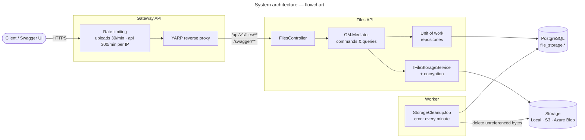
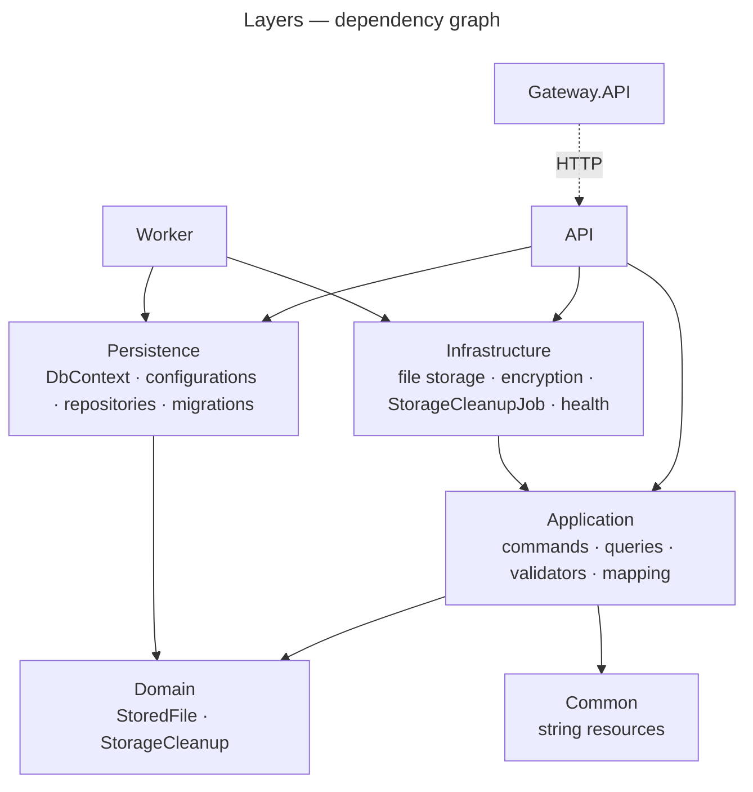
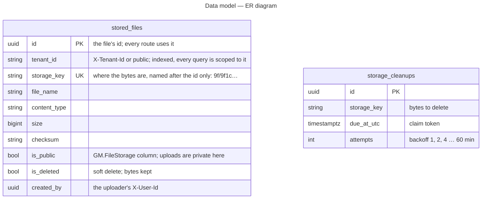

# Architecture

The sample runs as three processes that share one PostgreSQL catalog and one storage backend:

| Process | Project | Ports (dev) | Job |
| --- | --- | --- | --- |
| **Gateway** | `GM.FileStorage.Sample.Gateway.API` | `https://localhost:7141`, `http://localhost:5141` | The public edge: YARP reverse proxy (GM.Gateway), per-IP rate limits (GM.RateLimiting), Swagger UI |
| **Files API** | `GM.FileStorage.Sample.API` | `https://localhost:7140` | Serves every file request, applies migrations at startup |
| **Worker** | `GM.FileStorage.Sample.Worker` | none | Runs `StorageCleanupJob` every minute |

**Diagrams in this doc:** [System architecture](#system-architecture--flowchart) · [Layers](#layers--dependency-graph) · [Data model](#data-model--er-diagram)  
All diagrams: [index](README.md)

## System architecture — flowchart

- **Clients only talk to the gateway.** It forwards `/api/{version}/files/**` and `/swagger/**` to the API.
  It doesn't sign callers in: the actor headers (`X-Tenant-Id`, `X-User-Id`) pass through as the client sent them.
  Bodies are streamed through, never buffered, so large uploads and `Range` downloads pass unchanged.
- **The API holds no background work.** It serves requests and applies migrations at startup.
- **The worker holds no HTTP surface.** It reads the `storage_cleanups` queue and deletes the bytes that
  nothing points at any more.
- **The API and worker must see the same storage.** Both read `FileStorage:*`. Locally that's the shared
  `App_Data/file-storage` folder at the repository root; in the cloud it's the same bucket or container.

## Layers — dependency graph

The gateway references no sample project; it only knows the API's address. The worker uses the same
Persistence and Infrastructure as the API, but registers only what it needs (`AddWorkerInfrastructure`):
file storage with encryption (its integrity check reads files back, so it needs the same master keys), a
distributed lock and GM.Scheduling.

## Data model — ER diagram

All tables live in the `file_storage` schema. Domain events go to `domain_events.domain_events` in the same
transaction as the change that raised them.

`storage_cleanups` is not linked to `stored_files` by a foreign key. An entry names a storage key, and the
job checks at run time whether any file row still uses it: if one does, the entry is dropped without deleting
anything.

## Scaling out

Everything that has to be shared between instances switches to Redis when `Redis:ConnectionString` is set, and stays
in memory otherwise. Compose sets it and runs two workers; `dotnet run` and the tests don't.

| Piece | Without Redis (one instance) | With Redis (several instances) |
| --- | --- | --- |
| Gateway rate-limit counters | In-memory GM.Caching | `AddGMRedisCaching` + `AddGMRedisRateLimitStore`: every gateway counts against the same limits |
| Per-client file count (API) | In-memory | The same Redis store: every API instance counts against the same 30 a minute |
| Worker job lock | In-memory GM.DistributedLock | `AddGMRedisDistributedLock`: one worker runs the cleanup at a time. Claiming entries by their `due_at_utc` token keeps it safe even without a shared lock |
| Gateway destinations | One API address | Add destinations to the `files-api` cluster; YARP balances them |
| API | Stateless apart from the above | Run as many as needed. Each applies pending migrations at startup, so start one first on a new database |
| Storage | Local folder shared by API and worker | S3 or Azure Blob; a local folder only works when every process sees the same disk |

See [dependencies](dependencies.md), [user flows](user-flows.md) and [sequence diagrams](sequence-diagrams.md) for what happens on each call, and [configuration](configuration.md)
for the settings.
