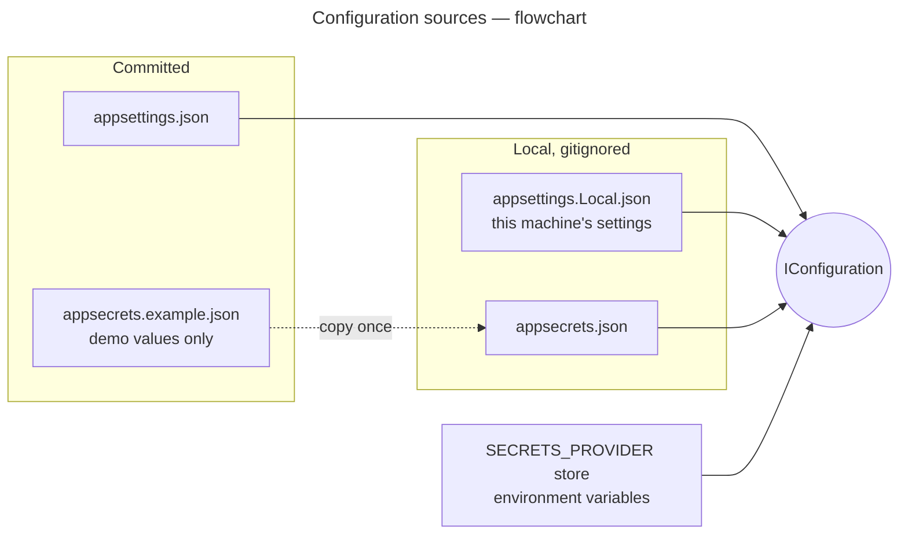

# Configuration

Each process reads `appsettings.json`, then `appsettings.Local.json` (gitignored, optional), then layers secrets over
them with GM.Secrets: `appsecrets.json` (gitignored), the store named by `SECRETS_PROVIDER`, and environment
variables. Settings that aren't secret live in `appsettings.json`, with this machine's own choices in
`appsettings.Local.json`; connection strings, cloud credentials and encryption keys live in `appsecrets.json`.

For example, to keep files on another disk, or in a bucket, without touching the committed defaults:

```jsonc
// appsettings.Local.json, next to appsettings.json in the API and in the worker
{
  "FileStorage": {
    "Provider": "S3",                         // or "AzureBlob", "Local"
    "Local": { "RootPath": "C:/Files" },
    "S3": { "BucketName": "my-bucket", "Region": "eu-north-1" },
    "AzureBlob": { "ContainerName": "my-container" }
  }
}
```

The keys for those (`FileStorage:S3:AccessKey` / `SecretKey`, `FileStorage:AzureBlob:ConnectionString`) go in
`appsecrets.json`.

**Diagrams in this doc:** [Configuration sources](#configuration-sources--flowchart)  
All diagrams: [index](README.md)

## Configuration sources — flowchart



## Who needs what

| Setting | Gateway | API | Worker | Where |
| --- | :-: | :-: | :-: | --- |
| `ReverseProxy:*` (routes, cluster address) | ✓ | | | appsettings.json |
| `RateLimiting:Policies:*`: the gateway's per-request limits, the API's `uploaded-files` (30 files a minute per client) | ✓ | ✓ | | appsettings.json |
| `Redis:ConnectionString` (share limits, counts, idempotency keys and the job lock across instances; unset: in memory). | ✓ | ✓ | ✓ | environment / appsecrets.json |
| `Idempotency:LockExpiry` (10 minutes: how long a request holds its `Idempotency-Key`, longer than an upload takes) | | ✓ | | appsettings.json |
| `Kestrel:Limits:MaxRequestBodySize` (60 MB) | ✓ | ✓ | | appsettings.json |
| `ConnectionStrings:ApplicationDatabase` | | ✓ | ✓ | appsecrets.json |
| `FileStorage:Provider`, `KeyTemplate`, upload rules | | ✓ | ✓¹ | appsettings.json (this machine: appsettings.Local.json) |
| `FileStorage:Local:RootPath` | | ✓ | ✓ | appsettings.json or appsettings.Local.json — must be the same folder |
| `FileStorage:S3:AccessKey` / `SecretKey`, `FileStorage:AzureBlob:ConnectionString` | | ✓ | ✓ | appsecrets.json |
| `FileStorage:Encryption:Enabled` (on), `ActiveKeyId` and `Keys` (the master keys; the worker's integrity check decrypts to verify) | | ✓ | ✓ | appsettings.json (on) / appsecrets.json (keys) |
| `Quotas:BytesPerTenant` (1 GB; 0 is unlimited) | | ✓ | | appsettings.json |
| `FileStorage:MalwareScanner:Enabled` (off; on, uploads are scanned and the integrity check rescans), `FileStorage:MalwareScanner:ClamAV:Host` / `Port` (`localhost:3310`) | | ✓ | ✓ | appsettings.json, or the environment (docker-compose.scanning.yml) |
| `Integrity:BatchSize` (files checked per run, every 5 minutes) | | | ✓ | appsettings.json |
| `Retention:DeletedFileDays` (30; 0 keeps deleted files forever), `Retention:BatchSize` | | | ✓ | appsettings.json |

¹ The worker only deletes objects, so of these it needs only `Provider` and the provider's own settings.

## Setting up the secrets

```bash
cp GM.FileStorage.Sample.API/appsecrets.example.json    GM.FileStorage.Sample.API/appsecrets.json
cp GM.FileStorage.Sample.Worker/appsecrets.example.json GM.FileStorage.Sample.Worker/appsecrets.json
```

The templates hold the docker-compose database's demo credentials and empty cloud placeholders. The gateway has
no secrets.

## Gateway

Routes are matched in order of specificity; each names a rate-limit policy and the partition (`Ip`). The gateway
doesn't sign callers in: the actor headers (`X-Tenant-Id`, `X-User-Id`) pass through as sent.

| Route | Match | Policy |
| --- | --- | --- |
| `files-upload` | `POST /api/{version}/files` | `uploads` |
| `files-batch-upload` | `POST /api/{version}/files/batch` | `uploads` |
| `files` | `/api/{version}/files/{**catch-all}` | `api` |
| `files-api-docs` | `GET /swagger/{**catch-all}` | none |

| Policy | Algorithm | Limit |
| --- | --- | --- |
| `uploads` | Sliding window | 30 per minute per IP |
| `api` | Sliding window | 300 per minute per IP |

Over the limit, the gateway answers `429` with `Retry-After`; every limited response carries
`X-RateLimit-*` headers.

The `files-api` cluster points at `https://localhost:7140/` with `DangerousAcceptAnyServerCertificate`, which is
only for the local dev certificate. In production, drop it and point at the API's real address.

Health: `/health/live` is the gateway itself, and `/health/ready` also calls the API's `/health/live`.

## Shared storage root

The API and worker run from their own project folders, so both point `FileStorage:Local:RootPath` at
`../App_Data/file-storage`, the repository root's `App_Data` folder. If the worker looked at a different folder,
its deletes would miss the API's files and the queue would back off forever.

## Storage keys

```jsonc
"FileStorage": {
  "KeyTemplate": "{meta:tenantId}/{date:yyyy}/{date:MM}/{date:dd}/{id}"   // → <tenant>/2026/11/07/9f1c…
}
```

See [Storage layout](../README.md#storage-layout) for the placeholders and other layouts.

## Upload rules

```jsonc
"FileStorage": {
  "MaxFileSize": 52428800,            // 50 MB
  "AllowedContentTypes": [
    "application/pdf",
    "application/msword",                                                       // .doc
    "application/vnd.openxmlformats-officedocument.wordprocessingml.document",  // .docx
    "image/*",
    "video/*"
  ],
  "VerifyContentType": true           // the bytes must match the declared type
}
```

Two size limits apply, and an upload is streamed, so both cut it off as soon as they're passed:

| Limit | Setting | Over it |
| --- | --- | --- |
| One file: 50 MB | `FileStorage:MaxFileSize` (API) | `400` naming the limit; nothing kept |
| One request: 60 MB | `Kestrel:Limits:MaxRequestBodySize` (gateway and API) | `413`; nothing kept, not even earlier files of a batch |

Kestrel doesn't read its `Limits` from configuration on its own, so both hosts bind the `Kestrel` section
explicitly; without that, its 30 MB default applies.

Anything else gets a `400` that names the type. To allow more, add its media type (or a `type/*` pattern) to
`AllowedContentTypes` in the API's appsettings.json; Excel, for example, is `application/vnd.ms-excel` and
`application/vnd.openxmlformats-officedocument.spreadsheetml.sheet`.

Send a file with its own media type. A file sent as `application/octet-stream` is checked under the type its
bytes reveal. For Office files that's only `application/zip` (`.docx`) or `application/x-ole-storage` (`.doc`),
which aren't allowed.
