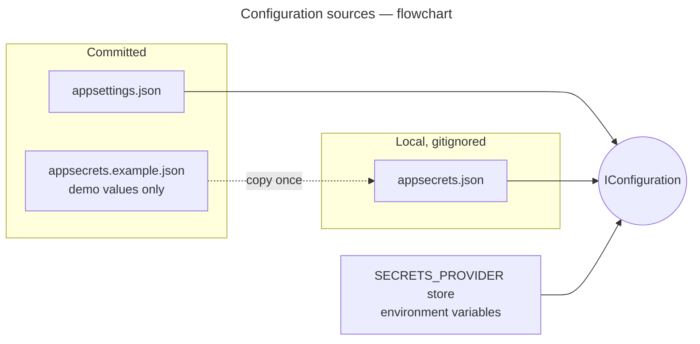

# Configuration

Each process reads `appsettings.json`, then layers secrets over it with GM.Secrets: `appsecrets.json`
(gitignored), the store named by `SECRETS_PROVIDER`, and environment variables. Settings that aren't secret live
in `appsettings.json`; connection strings, cloud credentials and encryption keys live in `appsecrets.json`.

**Diagrams in this doc:** [Configuration sources](#configuration-sources--flowchart)  
All diagrams: [index](README.md)

## Configuration sources — flowchart



## Who needs what

| Setting | Gateway | API | Worker | Where |
| --- | :-: | :-: | :-: | --- |
| `ReverseProxy:*` (routes, cluster address) | ✓ | | | appsettings.json |
| `RateLimiting:Policies:*` | ✓ | | | appsettings.json |
| `Kestrel:Limits:MaxRequestBodySize` (60 MB) | ✓ | ✓ | | appsettings.json |
| `ConnectionStrings:ApplicationDatabase` | | ✓ | ✓ | appsecrets.json |
| `FileStorage:Provider`, `KeyTemplate`, upload rules | | ✓ | ✓¹ | appsettings.json |
| `FileStorage:Local:RootPath` | | ✓ | ✓ | appsettings.json — must be the same folder |
| `FileStorage:S3:AccessKey` / `SecretKey`, `FileStorage:AzureBlob:ConnectionString` | | ✓ | ✓ | appsecrets.json |
| `FileStorage:Encryption:*` (master keys) | | ✓ | | appsecrets.json |

¹ The worker only deletes objects, so of these it needs only `Provider` and the provider's own settings.

## Setting up the secrets

```bash
cp GM.FileStorage.Sample.API/appsecrets.example.json    GM.FileStorage.Sample.API/appsecrets.json
cp GM.FileStorage.Sample.Worker/appsecrets.example.json GM.FileStorage.Sample.Worker/appsecrets.json
```

The templates hold the docker-compose database's demo credentials and empty cloud placeholders. The gateway has
no secrets.

## Gateway

Routes are matched in order of specificity; each names a rate-limit policy and the partition (`Ip`).

| Route | Match | Policy |
| --- | --- | --- |
| `files-upload` | `POST /api/{version}/files` | `uploads` |
| `files-replace` | `PUT /api/{version}/files/{id}/content` | `uploads` |
| `files` | `/api/{version}/files/{**catch-all}` | `api` |
| `files-api-docs` | `GET /swagger/{**catch-all}` | none |

| Policy | Algorithm | Limit |
| --- | --- | --- |
| `uploads` | Sliding window | 30 per minute per IP |
| `api` | Sliding window | 300 per minute per IP |

Over the limit, the gateway answers `429` with `Retry-After`; every limited response carries
`X-RateLimit-*` headers.

The `files-api` cluster points at `https://localhost:7140/` with `DangerousAcceptAnyServerCertificate`, which is
only for the local dev certificate. In production, drop it and point at the API's real address.

Health: `/health/live` is the gateway itself, and `/health/ready` also calls the API's `/health/live`.

## Shared storage root

The API and worker run from their own project folders, so both point `FileStorage:Local:RootPath` at
`../App_Data/file-storage`, the repository root's `App_Data` folder. If the worker looked at a different folder,
its deletes would miss the API's files and the queue would back off forever.

## Storage keys

```jsonc
"FileStorage": {
  "KeyTemplate": "{category}/{shard}/{id}{ext}"   // documents/9f/9f1c….pdf
}
```

See [Storage layout](../README.md#storage-layout) for the placeholders and other layouts.
