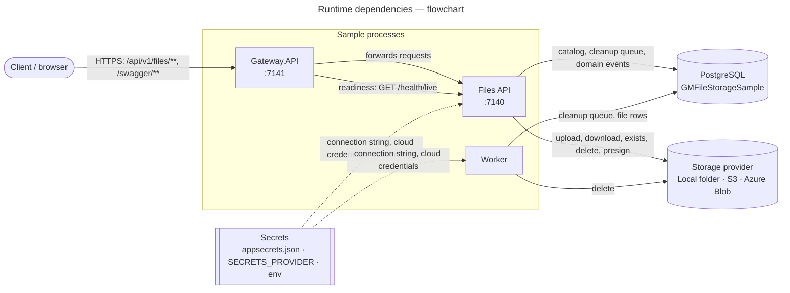
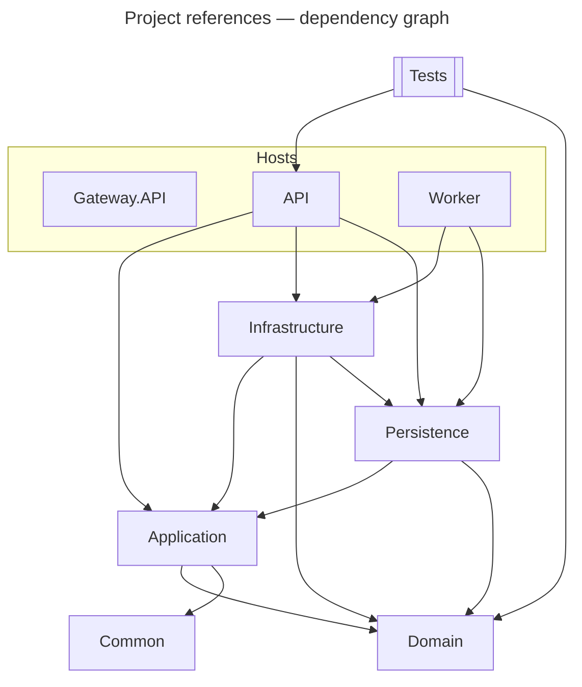
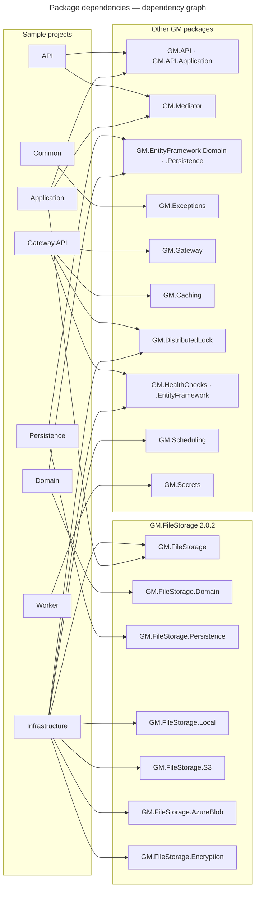
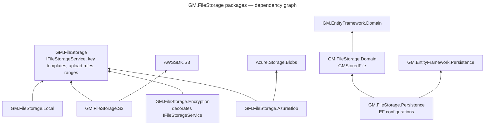
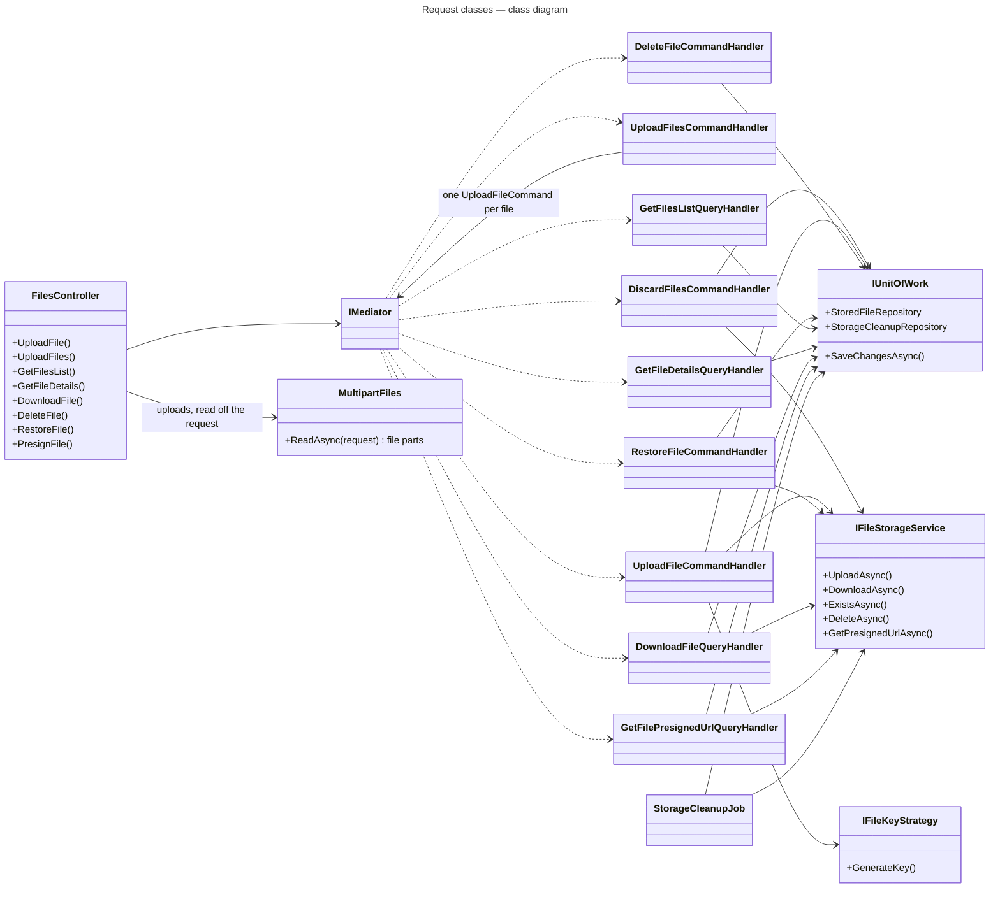
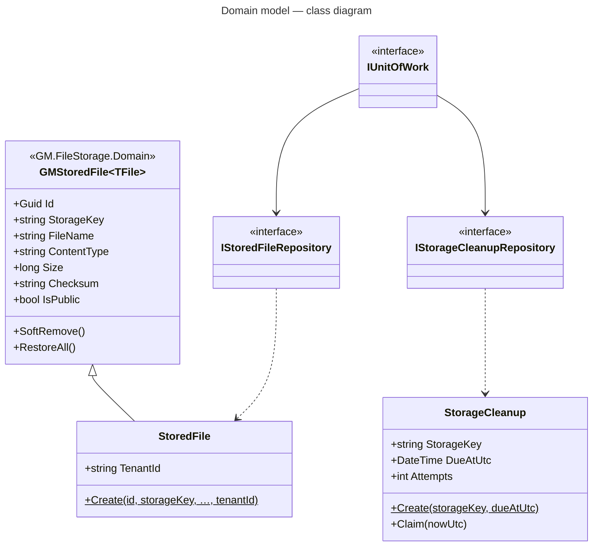

# Dependencies

Four views, from the outside in: what each process talks to at run time, how the projects reference each other,
which packages each project pulls in, and how the classes inside a request depend on each other.

**Diagrams in this doc:** [Runtime dependencies](#runtime-dependencies--flowchart) · [Project references](#project-references--dependency-graph) · [Package dependencies](#package-dependencies--dependency-graph) · [GM.FileStorage packages](#gmfilestorage-packages--dependency-graph) · [Request classes](#request-classes--class-diagram) · [Domain model](#domain-model--class-diagram)  
All diagrams: [index](README.md)

## Runtime dependencies — flowchart

| Process | Needs at startup | Needs per request / run |
| --- | --- | --- |
| Gateway | The API's address | The API |
| Files API | PostgreSQL (applies migrations), secrets | PostgreSQL, storage |
| Worker | Secrets | PostgreSQL, storage |

## Project references — dependency graph

- **Domain and Common reference no other sample project.** Everything points inward to them.
- **Application knows only the domain**, through `IUnitOfWork` and the repository interfaces, plus
  `IFileStorageService` from GM.FileStorage. It never sees EF Core or a storage provider.
- **Gateway.API references no sample project.** It only knows the API's URL from configuration.
- **The worker is the API without HTTP:** it shares Persistence and Infrastructure and registers its own subset
  (`AddWorkerInfrastructure`).

## Package dependencies — dependency graph

Third-party packages, by project:

| Project | Packages |
| --- | --- |
| Gateway.API | Swashbuckle.AspNetCore.SwaggerUI (UI only; the document comes from the API) |
| API | Asp.Versioning.Mvc, FluentValidation, Mapster, Microsoft.EntityFrameworkCore.Design |
| Application | Mapster |
| Persistence | Npgsql.EntityFrameworkCore.PostgreSQL, EFCore.NamingConventions (snake_case), EF Core Design/Tools |
| Tests | xunit, GM.Testing, GM.Testing.AspNetCore |

## GM.FileStorage packages — dependency graph

The storage half (`GM.FileStorage` and its providers) and the catalog half (`Domain` / `Persistence`) don't
reference each other. The sample is what joins them: a handler writes bytes through `IFileStorageService` and
records them through the unit of work.

## Request classes — class diagram

Delete, list and details touch only the catalog. Restore asks storage too, to check the bytes are still there.
The batch handler touches neither: it sends one `UploadFileCommand` per file back through the mediator, so each
file gets the same validation, rules and ordering as a single upload. Uploads never bind an `IFormFile`: the
controller reads file parts straight off the request with `MultipartFiles`, and `DiscardFilesCommand` (not exposed
over HTTP) undoes files stored by a request that's then refused.

## Domain model — class diagram

`StorageCleanup` names a storage key, not a file, so it has no link to `StoredFile`. The job checks at run time
whether any file still uses the key.
