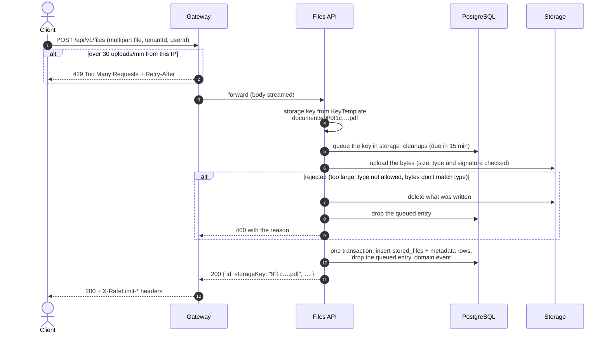
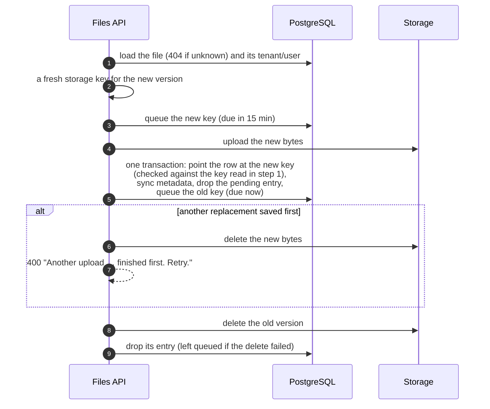
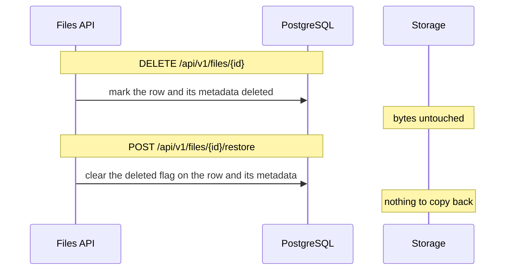
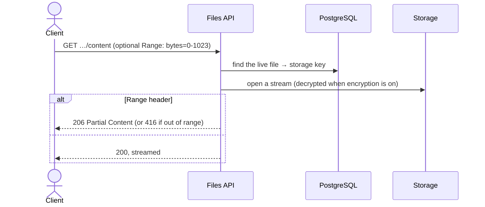

# Request flows

Every call below enters through the gateway, which checks the rate limit for its route and forwards it to the
files API. The gateway step is drawn once, in the upload; the other diagrams start at the API.

The bytes (in storage) and the row (in Postgres) can't share a transaction. Each write is ordered so that any
failure leaves at worst bytes nothing points at, and those are always queued in `storage_cleanups` for the
worker to delete.

## Upload — `POST /api/v1/files`



If the API crashes after step 6, the bytes exist but nothing points at them. The queued entry falls due 15
minutes later and the worker deletes them.

## Replace — `PUT /api/v1/files/{id}/content`



- The id stays the same; only the storage key changes. A replacement never overwrites bytes the catalog still
  points at.
- Tenant and user stay as they were unless the request gives new ones.
- Replacing a deleted file restores it.

## Delete and restore



A deleted file is hidden from the list, details, download and presign (except with `visibility=All`). Its
bytes are never queued for cleanup, so a restore is instant.

## Download — `GET /api/v1/files/{id}/content`



## Cleanup — the worker, every minute

```mermaid
sequenceDiagram
    autonumber
    participant W as StorageCleanupJob
    participant DB as PostgreSQL
    participant S as Storage

    W->>W: take the scheduling lock (one run at a time)
    W->>DB: up to 100 entries with due_at_utc ≤ now
    loop each entry, in its own scope
        alt a file row still uses this storage key
            W->>DB: drop the entry, keep the bytes
        else
            W->>DB: claim it: attempts + 1, push due_at_utc to<br/>1, 2, 4 … 60 min ahead (fails if someone else changed it)
            W->>S: delete the bytes
            alt deleted
                W->>DB: drop the entry
            else failed
                Note over W,DB: stays claimed; retried when due again
            end
        end
    end
```

Claiming by the `due_at_utc` concurrency token means the job and an upload slower than its 15-minute grace
period can't both act on the same entry: whichever saves second fails and backs off.
