# User flows

What a caller can do with a file, and every outcome they can get back. Each flow starts at the gateway
(`https://localhost:7141`); the [sequence diagrams](sequence-diagrams.md) show what happens inside.

## The file's lifecycle

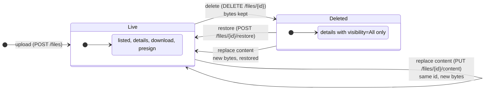

A file is never removed from the catalog through the API, and its current bytes are never deleted. Only the
bytes of previous versions and of uploads that were never recorded are deleted, by the worker.

## Every request: the gateway first

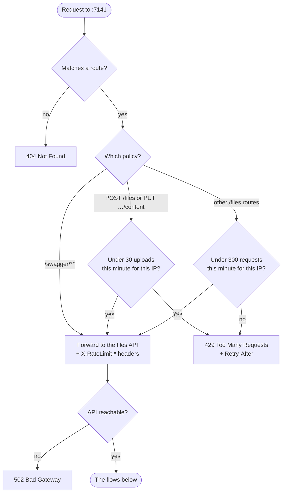

Bodies over 60 MB are refused (`413`) by the gateway and by the API.

## Upload a file

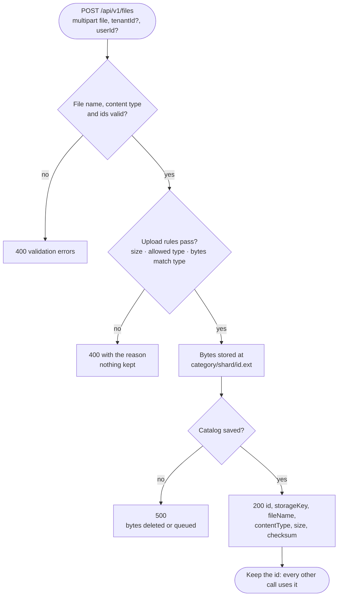

Without `tenantId` / `userId` the file is recorded under `public` / `anon`.

## Find files

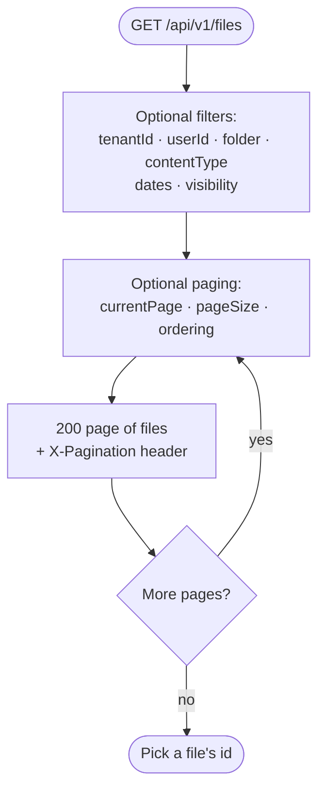

Deleted files are left out unless `visibility` includes them. An empty page is still `200`.

## View a file's details

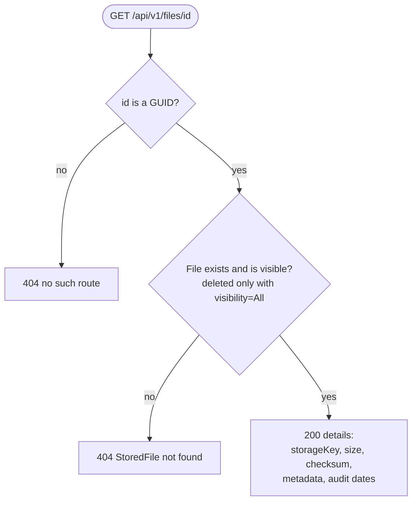

## Download a file

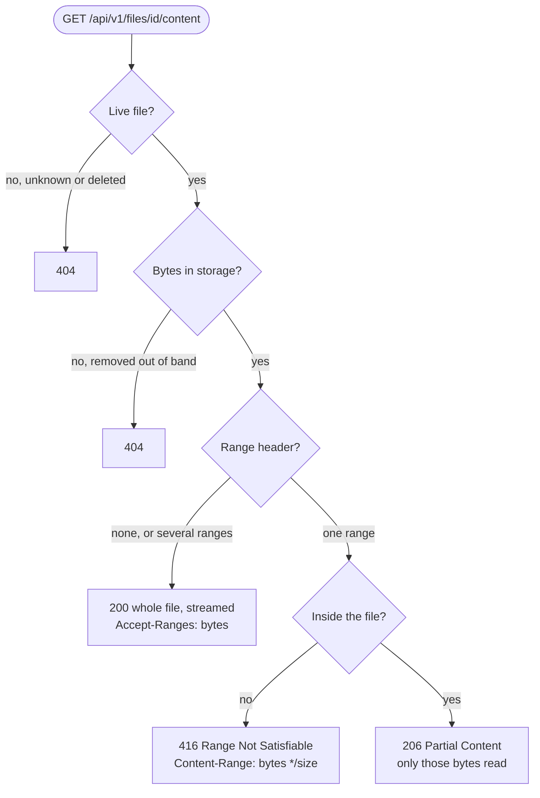

Ranges let video players seek and interrupted downloads resume. With encryption at rest on, the same responses
come back decrypted.

## Replace a file's content

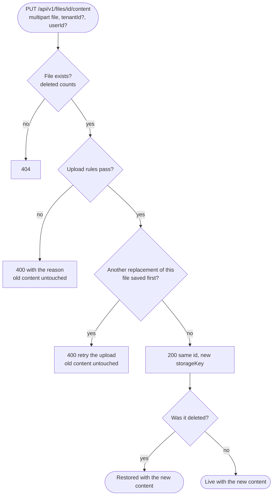

Tenant and user stay as they were unless the request gives new ones. The previous version's bytes are deleted
straight away, or by the worker if that fails.

## Delete a file

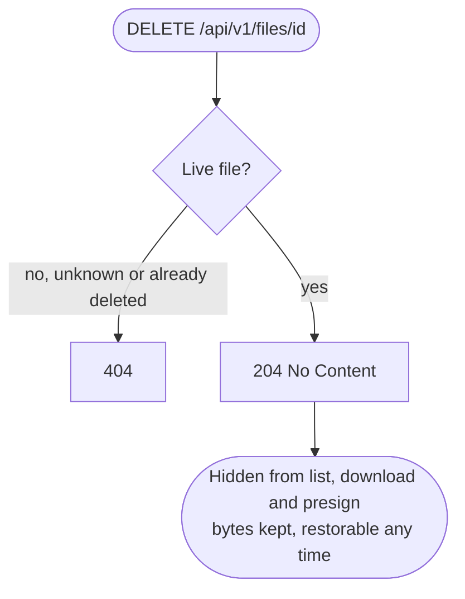

## Restore a file

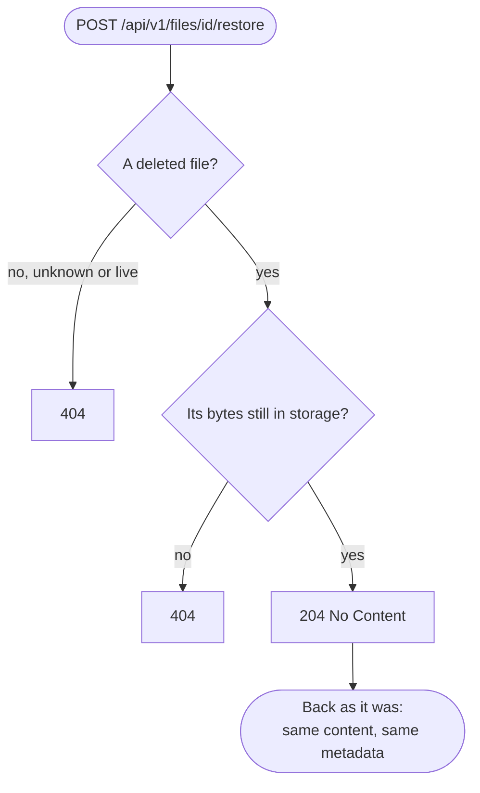

## Share a link

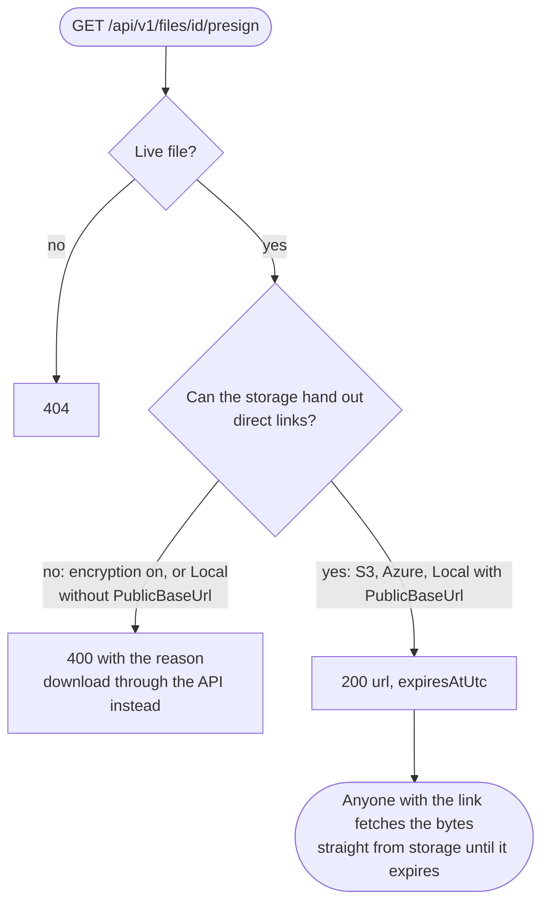

A link points at the current version's bytes. A replacement deletes those bytes straight away, so links handed
out before it stop working; ask for a new one.

## A typical session

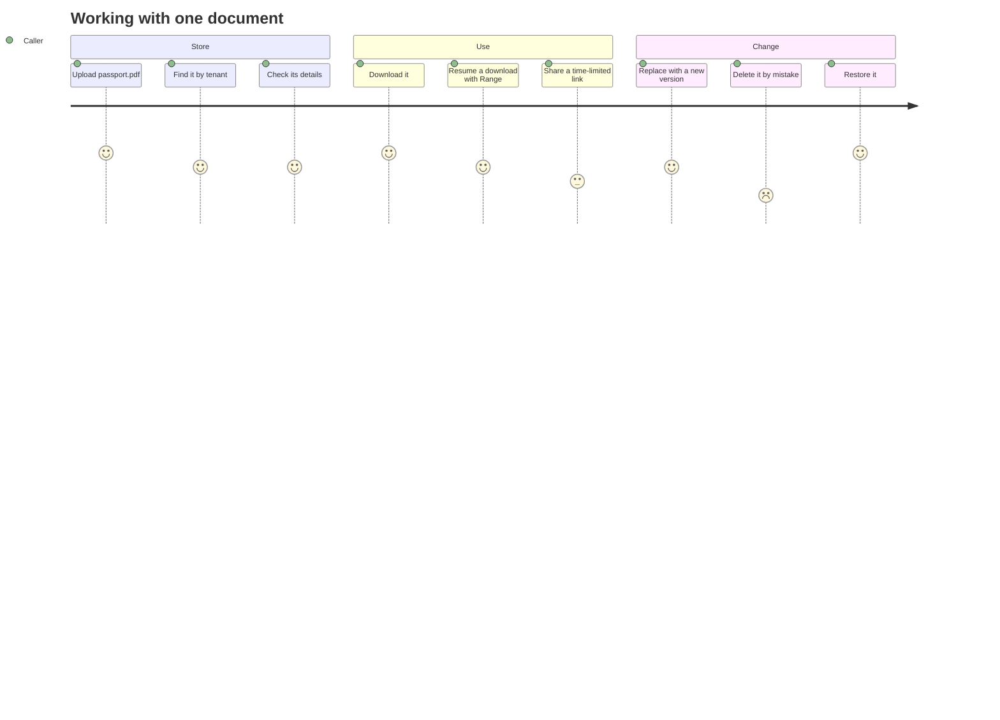
