# User flows

What a caller can do with a file, and every outcome they can get back. Each flow starts at the gateway
(`https://localhost:7141`); the [sequence diagrams](sequence-diagrams.md) show what happens inside.

**Diagrams in this doc:** [File lifecycle](#file-lifecycle--state-diagram) · [Gateway checks](#gateway-checks--user-flow) · [Upload](#upload--user-flow) · [Batch upload](#batch-upload--user-flow) · [List](#list--user-flow) · [Details](#details--user-flow) · [Download](#download--user-flow) · [Delete](#delete--user-flow) · [Restore](#restore--user-flow) · [Presign](#presign--user-flow) · [Typical session](#typical-session--user-journey)  
All diagrams: [index](README.md)

## File lifecycle — state diagram

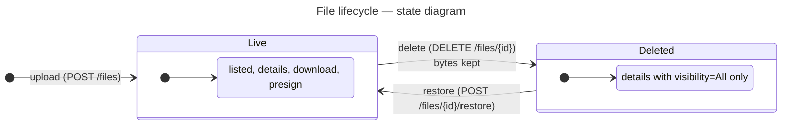

A file's content never changes after upload: there is no replace, and new content is a new file with a new id.
A file is never removed from the catalog through the API, and its bytes are never deleted. Only the bytes of
uploads that were never recorded are deleted, by the worker.

## Gateway checks — user flow

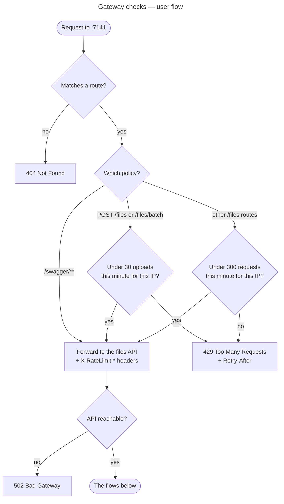

Bodies over 60 MB are refused (`413`) by the gateway and by the API. A batch counts as one upload, however many
files it holds.

## Upload — user flow

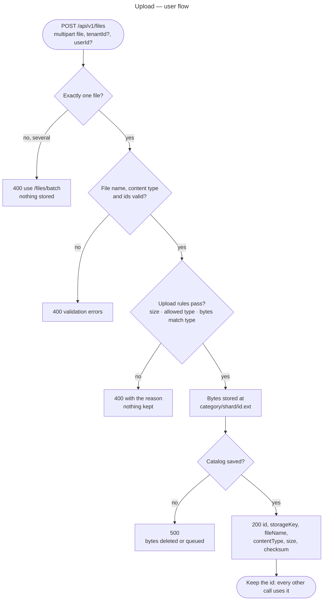

Without `tenantId` / `userId` the file is recorded under `public` / `anon`.

## Batch upload — user flow

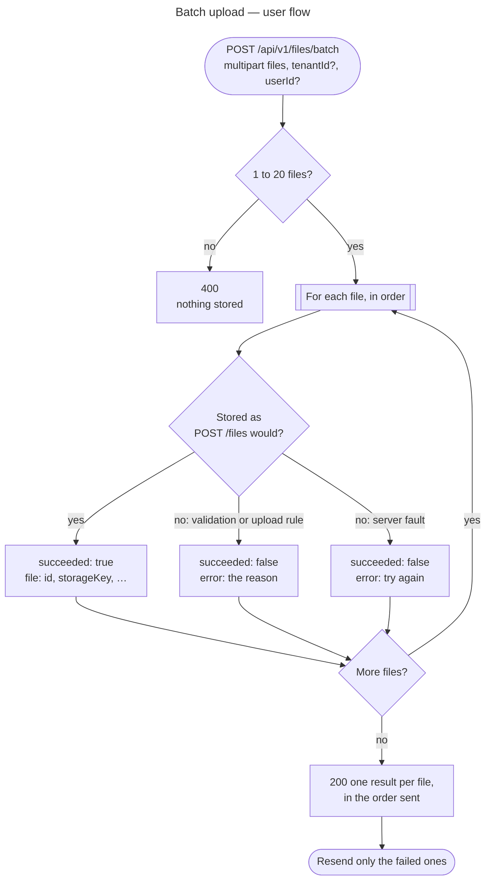

Each file is a file of its own, with its own id, stored exactly as a single upload. One bad file doesn't stop the
others, so the response is `200` even when some (or all) files failed: check `succeeded` on each result. The whole
request is still capped at 60 MB.

## List — user flow

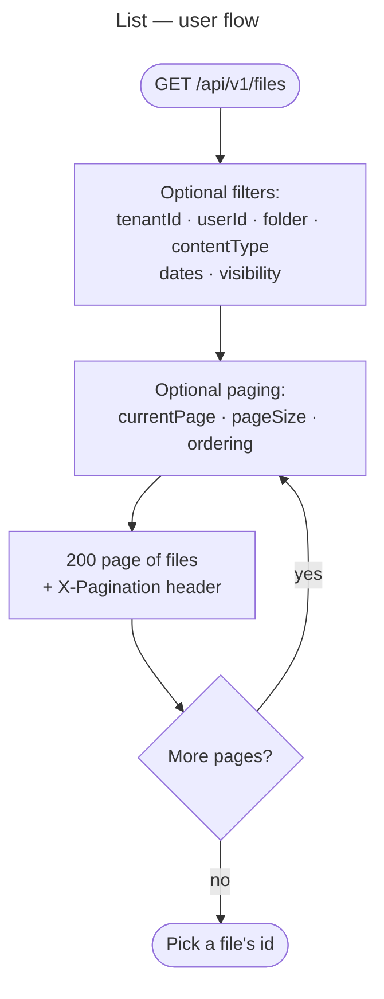

Deleted files are left out unless `visibility` includes them. An empty page is still `200`.

## Details — user flow

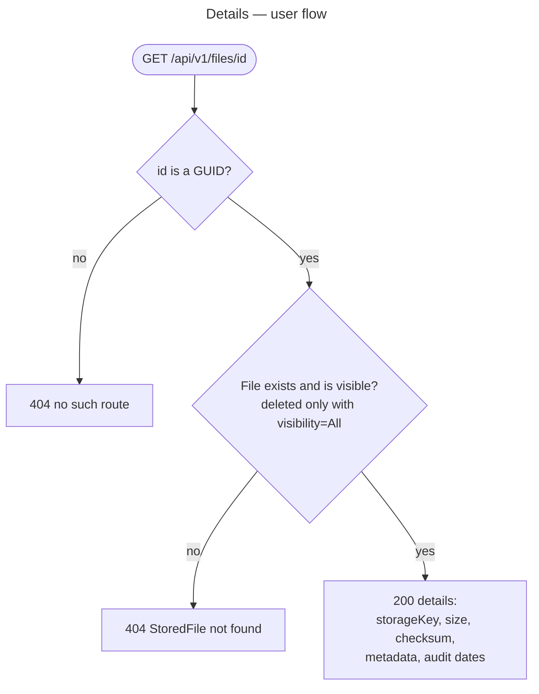

## Download — user flow

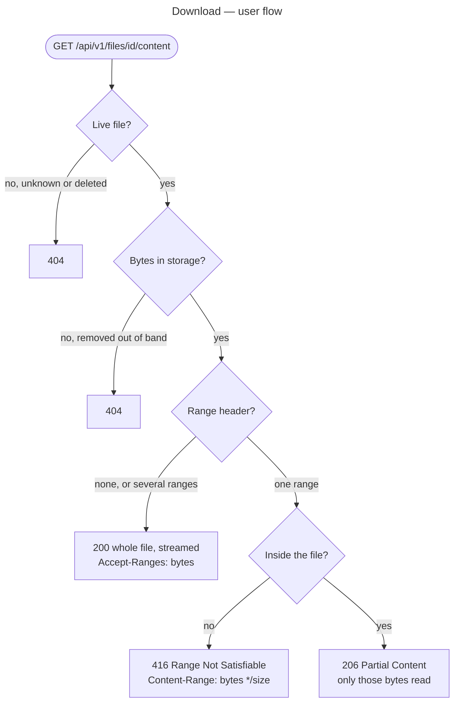

Ranges let video players seek and interrupted downloads resume. With encryption at rest on, the same responses
come back decrypted.

## Delete — user flow

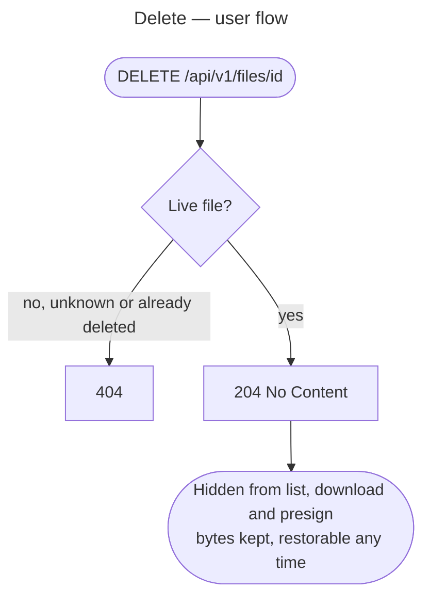

## Restore — user flow

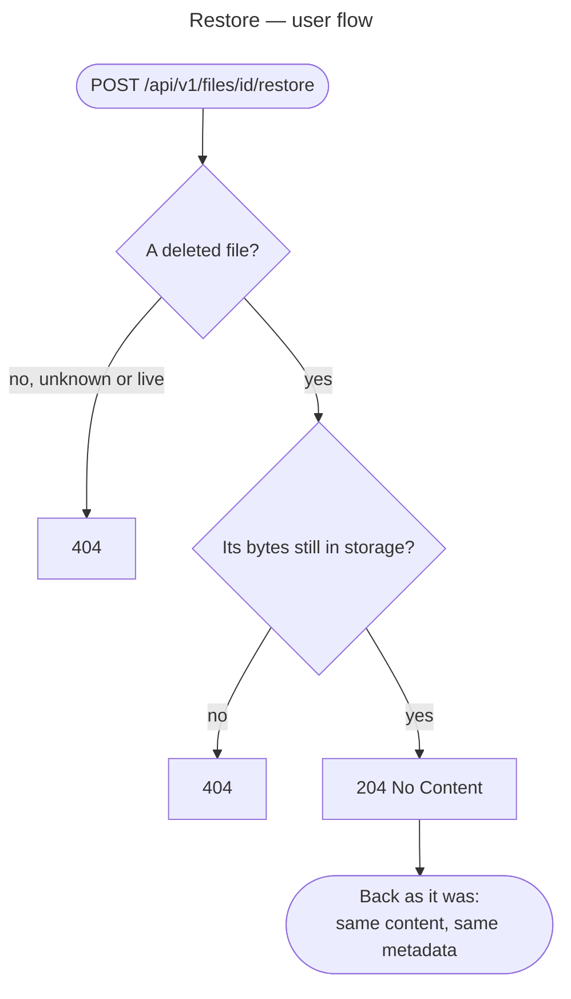

## Presign — user flow

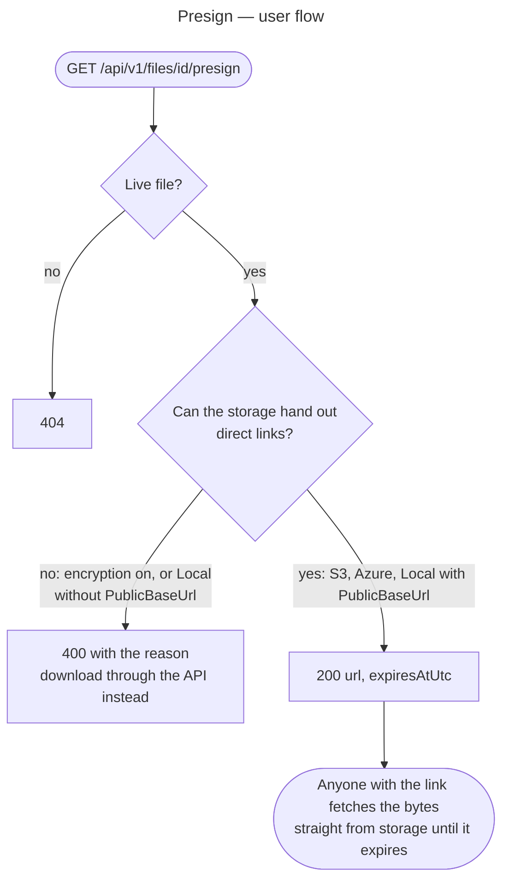

A file's content never changes, so a link always serves the bytes that were uploaded.

## Typical session — user journey

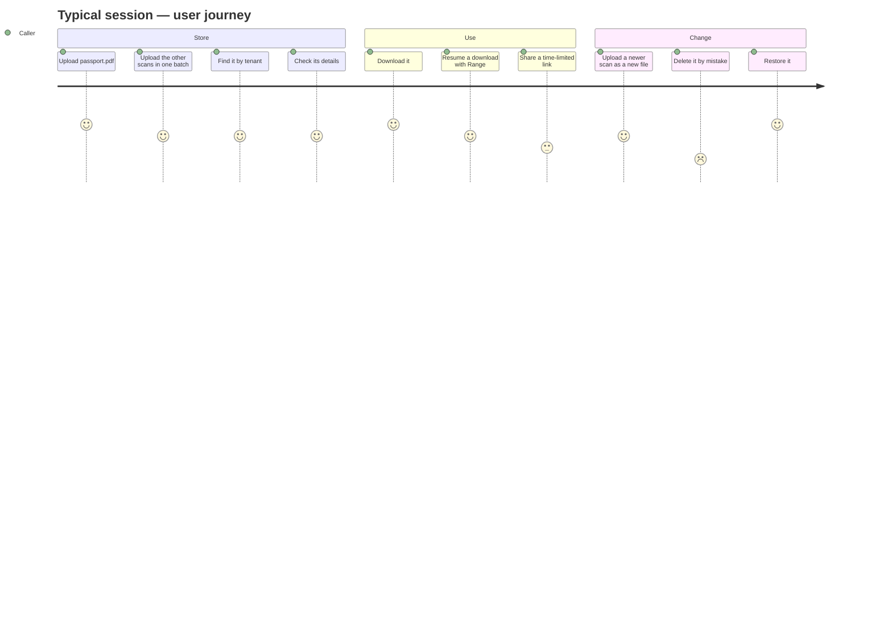
